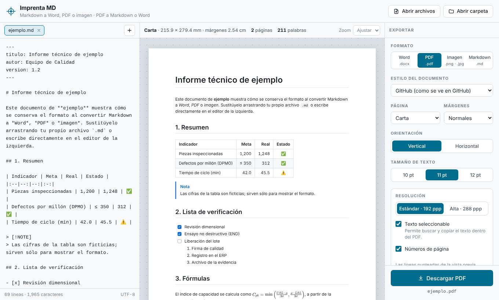

# Imprenta MD

[Español](README.md) · **English**

Converts **Markdown to Word, PDF or image**, and **PDF to Markdown or Word**, preserving the formatting. It runs entirely in the browser: your files are never uploaded to a server.

**Open the app:** https://alcazarfran77-dev.github.io/imprenta-md/



## What it does

- **Markdown → Word (.docx):** an editable document with heading styles, lists, tables, colored code and Word equations.
- **Markdown → PDF:** identical to the preview, with selectable text, links and bookmarks.
- **Markdown → image (PNG or JPG):** one long image or one per page.
- **PDF → Markdown or Word:** rebuilds headings, lists, code and links; detects tables (ruled, striped or simply aligned) and converts them to tables; extracts pictures and saves charts and diagrams as images.
- Supports tables, task lists, footnotes, GitHub alerts, formulas (KaTeX) and Mermaid diagrams.
- Letter, A4, Oficio and Legal page sizes; three document styles; converts several files at once.
- Interface in **Spanish or English**: switch with the ES / EN selector in the top bar; your choice is remembered.

## How to use it

1. Drag a `.md` or `.pdf` file into the window (or a folder with its images).
2. Check the preview and, if needed, fix the text in the editor.
3. Choose the format and press **Download**.

To use it without internet, download `index.html` and open it with a double click in Edge or Chrome. It is a single file and needs no installation.

## Limits

- Scanned PDFs (pages that are pictures) have no text to extract; they need OCR first.
- When converting from PDF, the structure is inferred from font size and text position. Review the result before downloading.
- Formulas in a PDF are not rebuilt.

## Development

The code lives in `src/`. `index.html` is the build output and includes every library.

```bash
npm install
npm run build   # generates index.html
```

| File | Contents |
| --- | --- |
| `src/template.html` | Page structure |
| `src/styles.css` | Interface and document styles |
| `src/app.js` | Preview and export to Word, PDF, image and Markdown |
| `src/pdf2md.js` | PDF to Markdown conversion |
| `src/i18n.js` | Interface texts in Spanish and English |
| `src/sample.md`, `src/sample.en.md` | Sample document in each language |
| `build.mjs` | Bundles everything into a single `index.html` |

## Credits

Built with [marked](https://github.com/markedjs/marked), [DOMPurify](https://github.com/cure53/DOMPurify), [highlight.js](https://highlightjs.org/), [KaTeX](https://katex.org/), [Mermaid](https://mermaid.js.org/), [docx](https://github.com/dolanmiu/docx), [jsPDF](https://github.com/parallax/jsPDF), [PDF.js](https://mozilla.github.io/pdf.js/), [modern-screenshot](https://github.com/qq15725/modern-screenshot) and [JSZip](https://stuk.github.io/jszip/).

## License

[MIT](LICENSE)
