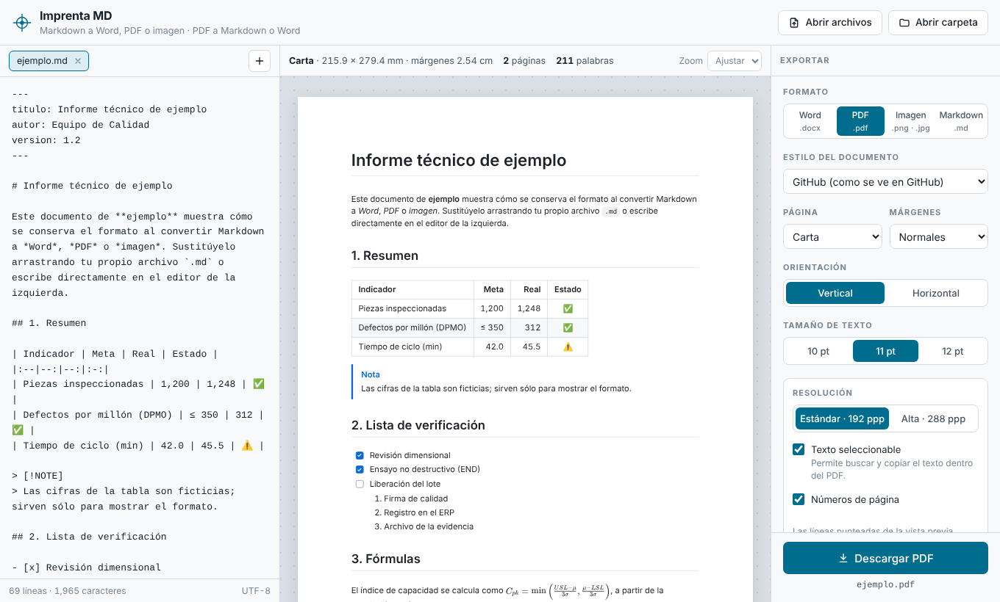

# Imprenta MD

**Español** · [English](README.en.md)

Convierte **Markdown a Word, PDF o imagen**, y **PDF a Markdown o Word**, conservando el formato. Funciona por completo en el navegador: los archivos no se suben a ningún servidor.

**Abrir la app:** https://alcazarfran77-dev.github.io/imprenta-md/



## Qué hace

- **Markdown → Word (.docx):** documento editable con estilos de título, listas, tablas, código coloreado y ecuaciones de Word.
- **Markdown → PDF:** igual a la vista previa, con texto seleccionable, enlaces y marcadores.
- **Markdown → imagen (PNG o JPG):** una imagen larga o una por página.
- **PDF → Markdown o Word:** reconstruye títulos, listas, tablas, código, enlaces e imágenes a partir del PDF.
- Admite tablas, listas de tareas, notas al pie, alertas de GitHub, fórmulas (KaTeX) y diagramas Mermaid.
- Tamaños carta, A4, oficio y legal; tres estilos de documento; conversión de varios archivos a la vez.
- Interfaz en **español o inglés**: se cambia con el selector ES / EN de la barra superior y la elección se recuerda.

## Cómo se usa

1. Arrastra un archivo `.md` o `.pdf` a la ventana (o una carpeta con sus imágenes).
2. Revisa la vista previa y, si hace falta, corrige el texto en el editor.
3. Elige el formato y pulsa **Descargar**.

Para usarla sin internet, descarga `index.html` y ábrelo con doble clic en Edge o Chrome. Es un solo archivo y no requiere instalación.

## Límites

- Los PDF escaneados (páginas que son fotos) no tienen texto que extraer; necesitan pasar antes por un OCR.
- Al convertir desde PDF, la estructura se deduce del tamaño de letra y la posición del texto. Conviene revisar el resultado antes de descargar.
- Las fórmulas de un PDF no se reconstruyen.

## Desarrollo

El código está en `src/`. `index.html` es el resultado de la compilación e incluye todas las librerías.

```bash
npm install
npm run build   # genera index.html
```

| Archivo | Contenido |
| --- | --- |
| `src/template.html` | Estructura de la página |
| `src/styles.css` | Estilos de la interfaz y del documento |
| `src/app.js` | Vista previa y exportación a Word, PDF, imagen y Markdown |
| `src/pdf2md.js` | Conversión de PDF a Markdown |
| `src/i18n.js` | Textos de la interfaz en español e inglés |
| `src/sample.md`, `src/sample.en.md` | Documento de ejemplo en cada idioma |
| `build.mjs` | Une todo en un solo `index.html` |

## Créditos

Usa [marked](https://github.com/markedjs/marked), [DOMPurify](https://github.com/cure53/DOMPurify), [highlight.js](https://highlightjs.org/), [KaTeX](https://katex.org/), [Mermaid](https://mermaid.js.org/), [docx](https://github.com/dolanmiu/docx), [jsPDF](https://github.com/parallax/jsPDF), [PDF.js](https://mozilla.github.io/pdf.js/), [modern-screenshot](https://github.com/qq15725/modern-screenshot) y [JSZip](https://stuk.github.io/jszip/).

## Licencia

[MIT](LICENSE)
