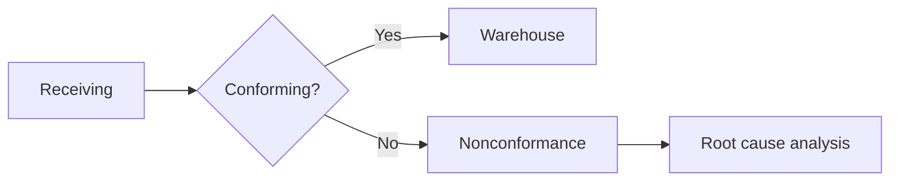

# Sample technical report

This **sample** document shows how formatting is preserved when converting Markdown to *Word*, *PDF* or an *image*. Replace it by dragging in your own `.md` file, or type directly in the editor on the left.

## 1. Summary

| Indicator | Target | Actual | Status |
|:--|--:|--:|:-:|
| Parts inspected | 1,200 | 1,248 | ✅ |
| Defects per million (DPMO) | ≤ 350 | 312 | ✅ |
| Cycle time (min) | 42.0 | 45.5 | ⚠️ |

> [!NOTE]
> The figures in the table are made up; they only illustrate the formatting.

## 2. Checklist

- [x] Dimensional inspection
- [x] Non-destructive testing (NDT)
- [ ] Lot release
    1. Quality sign-off
    2. ERP record
    3. Evidence filed

## 3. Formulas

The capability index is computed as $C_{pk} = \min\left(\frac{USL-\mu}{3\sigma}, \frac{\mu-LSL}{3\sigma}\right)$, from the sample standard deviation:

$$
s = \sqrt{\frac{1}{N-1}\sum_{i=1}^{N}\left(x_i-\bar{x}\right)^2}
$$

## 4. Code

```python
def dpmo(defects: int, units: int, opportunities: int) -> float:
    """Defects per million opportunities."""
    return defects / (units * opportunities) * 1_000_000

print(f"{dpmo(39, 1248, 100):.1f}")  # 312.5
```

## 5. Process flow



## 6. Final notes

> Quality is never an accident; it is always the result of intelligent effort.
> — John Ruskin

See the [GitHub syntax guide](https://docs.github.com/en/get-started/writing-on-github) for everything Markdown supports.[^1] You can also use ~~strikethrough~~, <kbd>Ctrl</kbd> + <kbd>S</kbd> and <mark>highlighted</mark> text.

---

[^1]: Footnotes are placed at the end of the document, just like on GitHub.
