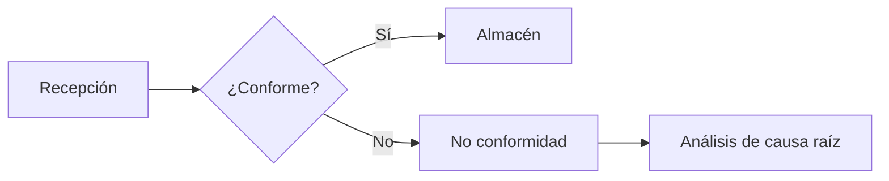

# Informe técnico de ejemplo

Este documento de **ejemplo** muestra cómo se conserva el formato al convertir Markdown a *Word*, *PDF* o *imagen*. Sustitúyelo arrastrando tu propio archivo `.md` o escribe directamente en el editor de la izquierda.

## 1. Resumen

| Indicador | Meta | Real | Estado |
|:--|--:|--:|:-:|
| Piezas inspeccionadas | 1,200 | 1,248 | ✅ |
| Defectos por millón (DPMO) | ≤ 350 | 312 | ✅ |
| Tiempo de ciclo (min) | 42.0 | 45.5 | ⚠️ |

> [!NOTE]
> Las cifras de la tabla son ficticias; sirven sólo para mostrar el formato.

## 2. Lista de verificación

- [x] Revisión dimensional
- [x] Ensayo no destructivo (END)
- [ ] Liberación del lote
    1. Firma de calidad
    2. Registro en el ERP
    3. Archivo de la evidencia

## 3. Fórmulas

El índice de capacidad se calcula como $C_{pk} = \min\left(\frac{USL-\mu}{3\sigma}, \frac{\mu-LSL}{3\sigma}\right)$, a partir de la desviación estándar muestral:

$$
s = \sqrt{\frac{1}{N-1}\sum_{i=1}^{N}\left(x_i-\bar{x}\right)^2}
$$

## 4. Código

```python
def dpmo(defectos: int, unidades: int, oportunidades: int) -> float:
    """Defectos por millón de oportunidades."""
    return defectos / (unidades * oportunidades) * 1_000_000

print(f"{dpmo(39, 1248, 100):.1f}")  # 312.5
```

## 5. Flujo del proceso



## 6. Notas finales

> La calidad nunca es un accidente; siempre es el resultado de un esfuerzo inteligente.
> — John Ruskin

Consulta la [guía de sintaxis de GitHub](https://docs.github.com/es/get-started/writing-on-github) para ver todo lo que admite Markdown.[^1] También puedes usar ~~tachado~~, <kbd>Ctrl</kbd> + <kbd>S</kbd> y texto <mark>resaltado</mark>.

---

[^1]: Las notas al pie se colocan al final del documento, igual que en GitHub.
